# Simple-Landing-Zone-for-NC2-on-Azure-with-S2S-VPN-and-NVA

A sample of Azure Network landing zone in Terraform for Nutanix Cloud Cluster with an Hub VNet, Site to Site VPN and a Firewall (NVA - Network Virtual Appliance)


 

## Scenario interconnection with an Azure VPN Gateway on a Hub and Spoke topology with a Network Virtual Appliance (Here Azure Firewall) that control outbound traffic to Internet.

This repo contains Terraform files and procedures to deploy all Azure network components that are preerquisites to a Nutanix Cloud Cluster (NC2) on Azure Baremetal deployment & to configure Nutanix Flow VPC (NAT and routing path).

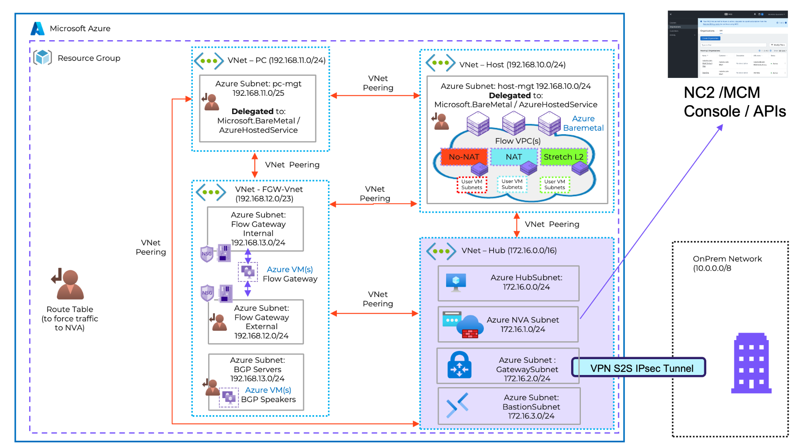 

__Warning__ : This code applies for the following scenarios :

- You access this cluster (and its workloads) from an on-premises network through a Site to Site VPN IPsec tunnel (between an Azure VPN Gateway and your IPsec VPN Gateway)) and an Azure [Hub and Spoke Topology](https://learn.microsoft.com/en-us/azure/architecture/networking/architecture/hub-spoke?tabs=cli). If you are using ExpressRoute (instead of Site to Site VPN) or Azure vWAN (instead of traditionnal Hub & Spoke) then this Landing Zone does not apply.


_Notes_: On Azure Firewall I simply define an allow outbound trafic network rule. You should restrict communications according to best practices and prerequisite here : https://portal.nutanix.com/page/documents/solutions/details?targetId=TN-2156-NC2-on-Azure:tn-outbound-communication.html

## Prerequisites for this Landing Zone

- All prerequisites for NC2 : https://portal.nutanix.com/page/documents/details?targetId=Nutanix-Cloud-Clusters-Azure:nc2-clusters-azure-getting-ready-for-deployment-c.html

- An Azure Subscription with enough privileges (create RG, Virtual Machine ...)
- Azure CLI 2.9 or >: <https://docs.microsoft.com/en-us/cli/azure/install-azure-cli?view=azure-cli-latest>
- Terraform CLI 1.17.2 or > : <https://www.terraform.io/downloads.html>

You can also clone this repo in your [Azure Cloud Shell](https://shell.azure.com) (that has all tools installed)

## Step by step operations

### Deployment of Azure component using Terraform

__Read the code and comments to understand what Azure resources will be created.__

Duplicate [example-configuration.tfvars](example-configuration.tfvars) to configuration.tfvars to define your Azure resources names.
 

1. Terraform Init phase  

```bash
terraform init
```

2. Terraform Plan phase

```bash
terraform plan --var-file=configuration.tfvars
```

3. Terraform deployment phase (add TF_LOG=info at the beginning of the following command line if you want to see what's happen during deployment)

```bash
terraform apply --var-file=configuration.tfvars
```

4. Wait until the end of deployment (It should take less than 45 minute, Azure VPN Gateway is the longuest resource to deploy)

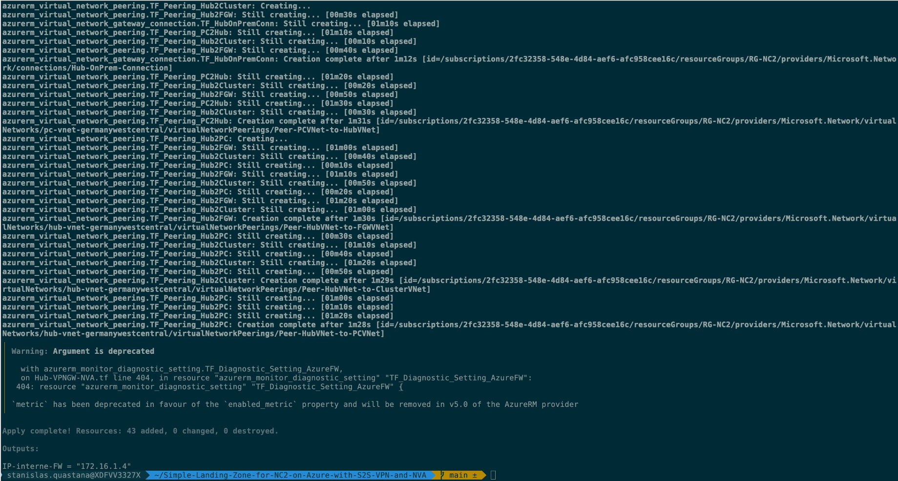 

Check on Azure Portal what Azure Resources were created by the terraform deployment

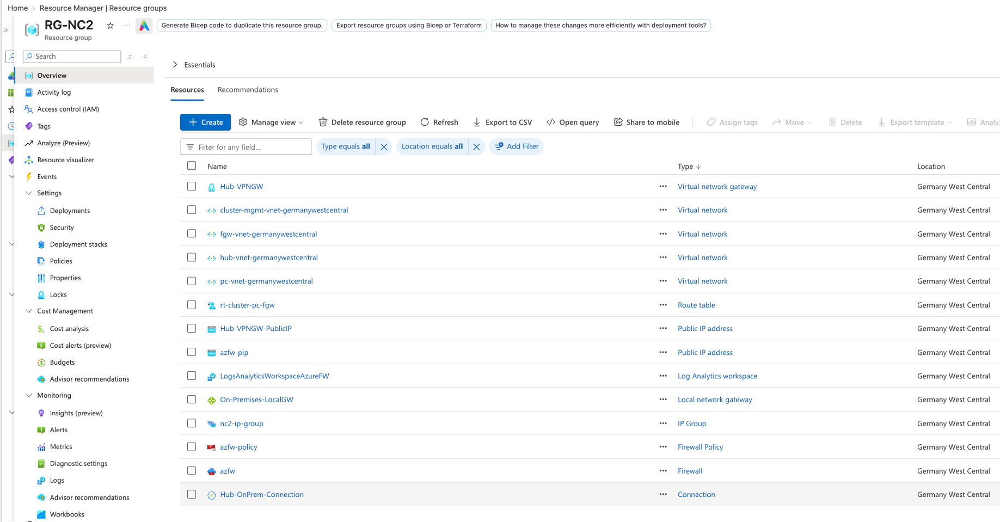 

If later you want to connect to Prism Element or Prism Central through Internet, there is an option to enable an Azure Bastion instance and a Windows Server 2025 Virtual Machine Jumbox.

### Deployment of Nutanix Cloud Cluster (NC2) on this Azure Landing Zone

 Go to Nutanix [NC2 Portal](https://cloud.nutanix.com) https://cloud.nutanix.com and start your Nutanix Cluster deployment wizard. In steps 4 (Network), 5 (Prism Central) and 6 (Flow Networking) select the Virtuals Networks and Subnets created in step 3 using terraform. Do forget to check "Use NVA for outbound connectivity"

 

Don't forget to select Azure VPN

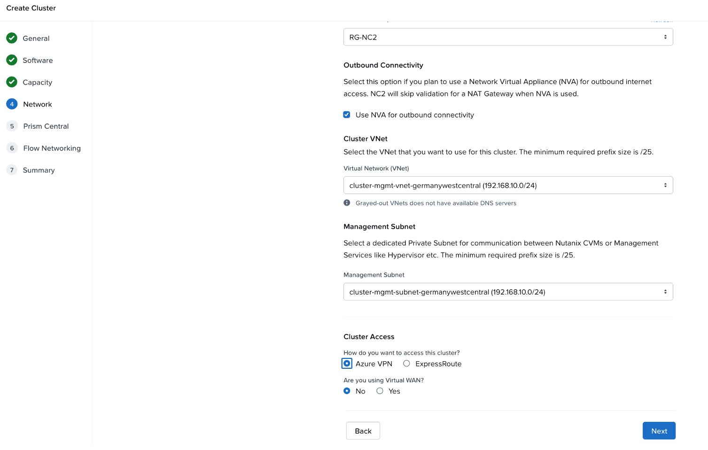 

Select the VNet and subnet for Nutanix Prism Central


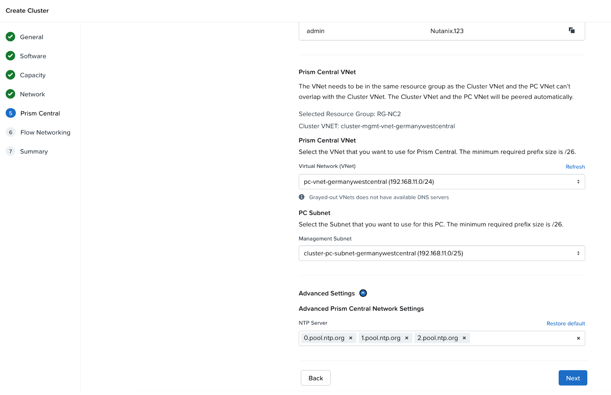 

Finally select the VNet and subnets for Flow Gateways

 

### Additional Networking configuration

After the deployment is successfull, __you have additional steps to perform for routing (and optionnaly firewalling) to and from on-premises network__ :

- Option 1 - Every traffic should pass through the NVA (here Azure Firewall) --> change the routing table assigned to Hub Subnets (especially GatewaySubnet) to avoid assymetric routing (network request from NC2 cluster going through NVA and network answer not going through NVA)

- Option 2 - Communication between NC2 cluster (and its workloads) and on-premises Datacenter do no go through NVA. Only network traffic from NC2 cluster (and it workloads) to Internet goes through the NVA.

__EXTRA IMPORTANT : Next steps documented are for Option 2__

1. __Update Azure Route Table associated to NC2 subnets__

Update the route table associated to NC2 subnets (ClusterMngt, PC, FlowExternal, BGP) and add a route to on-premises CIDR that use VNet as next hop.

There is no "exception" mechanism in an Azure route table. Instead, you add a more specific route. Azure always selects the longest prefix match, meaning a 10.0.0.0/16 route takes precedence over 0.0.0.0/0, regardless of its origin (UDR, BGP, or system).

Prerequisite: Peering configuration :

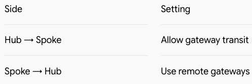 

Let's add a route to on premises CIDR

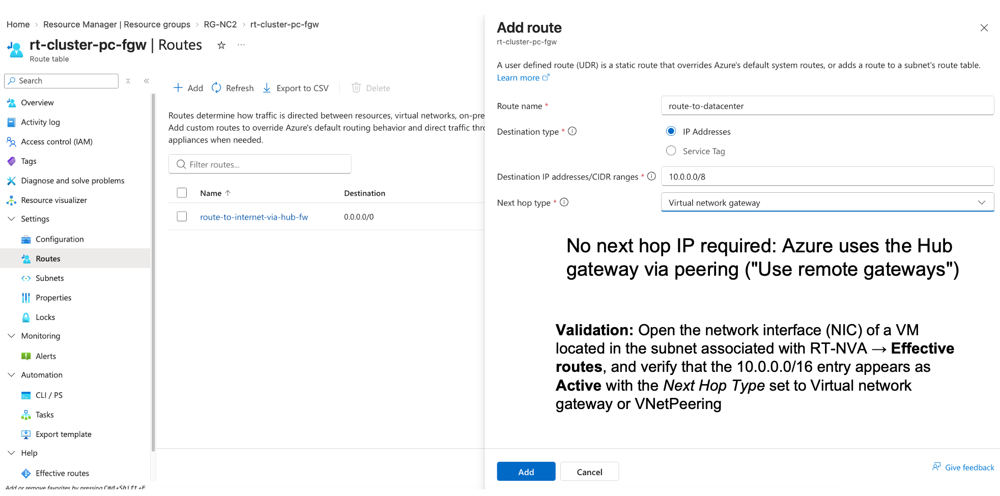 

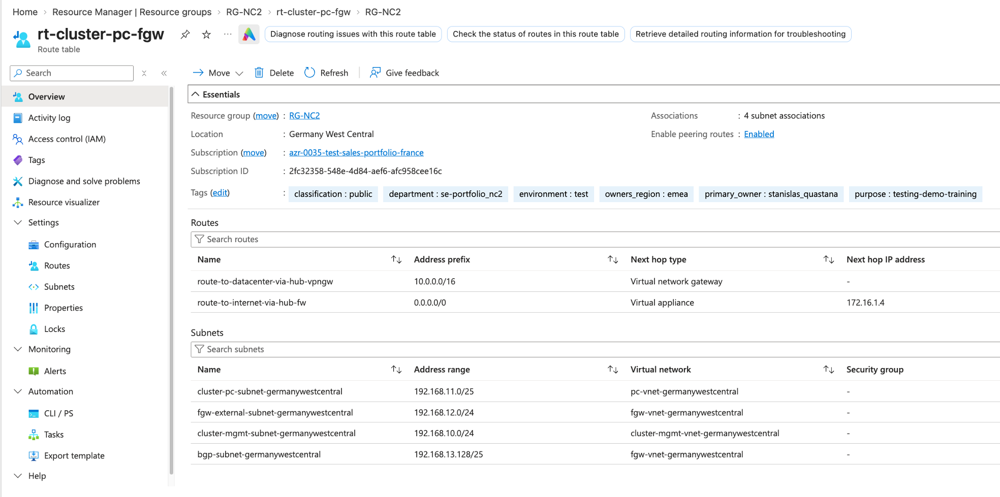 


2. __Connection to Prism Central and Nutanix Flow Networking configuration__ : [Flow VPC](https://squasta.github.io/configurationvpcazure.html) using NAT and NoNAT (= routing path).

- Create a Nutanix Flow VPC with NoNAT (routing) path

Create first a Nutanix VPC 

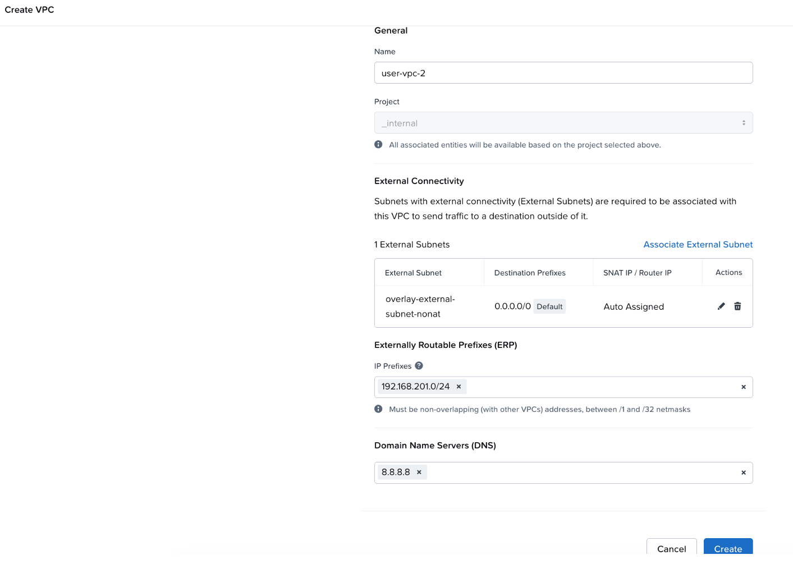 

Then create a Nutanix Subnet in the Nutanix VPC

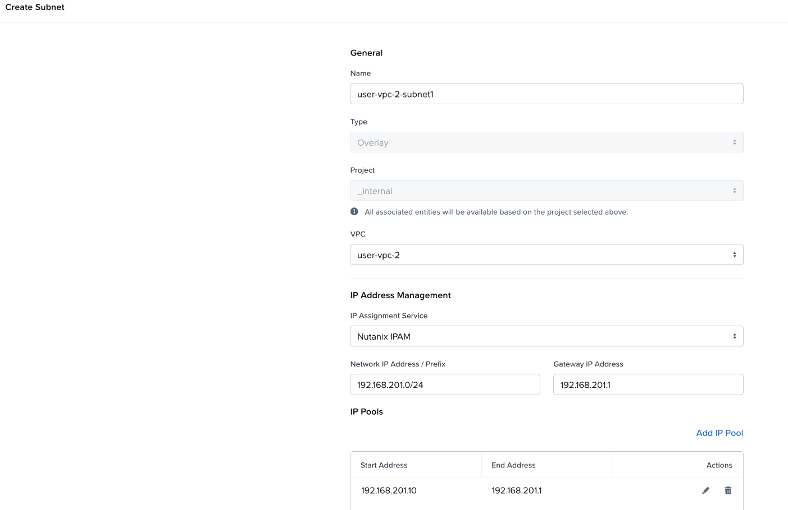 

IMPORTANT : 

- Do not forget to create on premises, IP Routes to FLOW VPC CIDRs (will go through VPN Tunnel to Azure) 

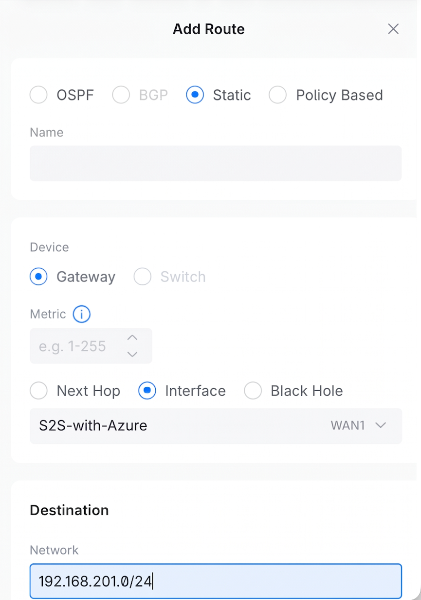 

- Do not forget to Add routes (via UDR) to Flow VPC CIDRs for the Gateway Subnet (Remember : Azure doesn't know by default CIDR ranges inside Nutanix Flow Networking)

First get the external IP address of Flow Gateway in [NC2 console](https://cloud.nutanix.com)

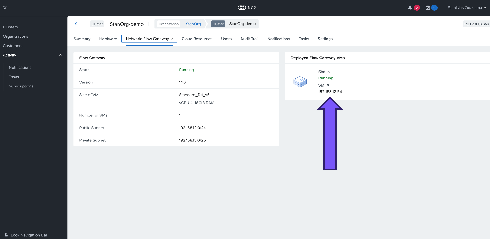 

You can create Azure Route Table and Routes using a terraform code, Azure Portal or via Azure CLI. Here are the commands using Azure CLI (Available in Azure Cloud Shell) :

```bash

# 1. Create an Azure Route Table for AzureGatewaySubnet (it can be also used by other subnets like HubSubnet)
  az network route-table create \
  --resource-group RG-NC2 \
  --name RT-FLOW-VPCS \
  --location germanywestcentral \
  --disable-bgp-route-propagation true

# 2. Add routes to Nutanix Flow CIDRs (aka ERP : Externally Routable Prefixes)   
az network route-table route create \
  --resource-group RG-NC2 \
  --route-table-name RT-FLOW-VPCS \
  --name default-to-user-vpc-2-subnet1 \
  --address-prefix 192.168.201.0/24 \
  --next-hop-type VirtualAppliance \
  --next-hop-ip-address 192.168.12.54

# 3. Associate Azure Route Table to GatewaySubnet in Azure Hub VNet
az network vnet subnet update \
  --resource-group RG-NC2 \
  --vnet-name hub-vnet-germanywestcentral \
  --name GatewaySubnet \
  --route-table RT-FLOW-VPCS

```

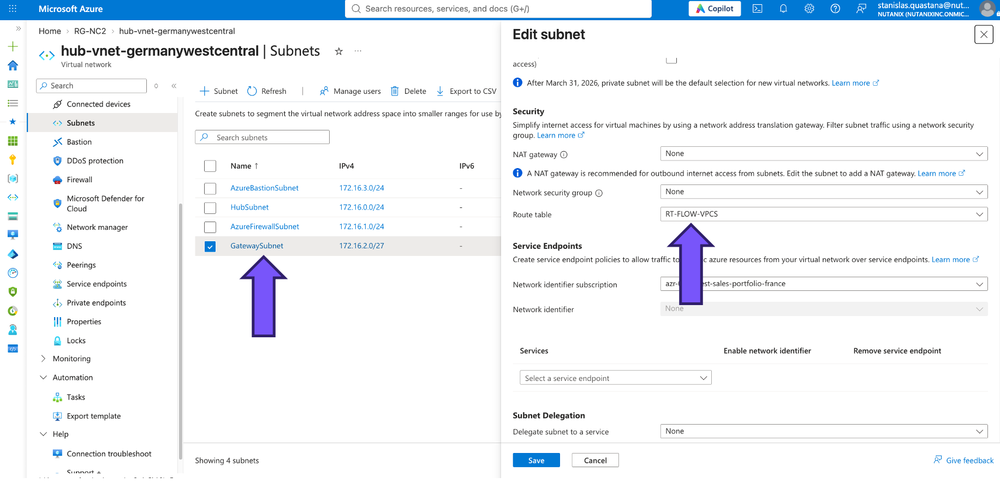 

At that moment, your Azure landing zone should be like that :

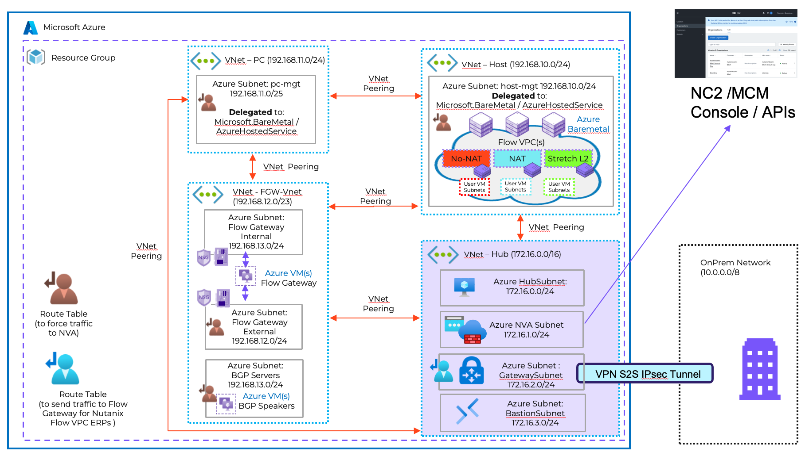 


- Create __a dedicated Route Table for Azure Firewall Subnet__.

This is mandatory because :

1- there is only one Azure Route Table that can be associated to an Azure Subnet

2- Route table on AzureFirewallSubnet must have 0.0.0.0/0 route direct to Internet

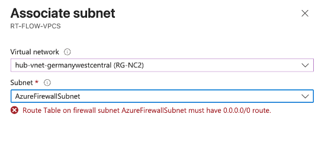 

3- We want to control outbound access to Internet through Azure Firewall (our NVA) so we have 0.0.0.0/0 route to AzureFirewallNVA in other Route Table (RT-FLOW-VPCS)


```bash
# 1. Create an Azure Route Table for AzureFirewall subnet
  az network route-table create \
  --resource-group RG-NC2 \
  --name RT-AzureFirewall\
  --location germanywestcentral 
 # --disable-bgp-route-propagation true

# 2. Add routes to Nutanix Flow CIDRs and to Internet 
az network route-table route create \
  --resource-group RG-NC2 \
  --route-table-name RT-AzureFirewall \
  --name default-to-user-vpc-2-subnet1 \
  --address-prefix 192.168.201.0/24 \
  --next-hop-type VirtualAppliance \
  --next-hop-ip-address 192.168.12.54

az network route-table route create \
  --resource-group RG-NC2 \
  --route-table-name RT-AzureFirewall \
  --name default-to-Internet \
  --address-prefix 0.0.0.0/0 \
  --next-hop-type Internet


# 3. Associate Azure Route Table to AzureFirewallSubnet in Azure Hub VNet
az network vnet subnet update \
  --resource-group RG-NC2 \
  --vnet-name hub-vnet-germanywestcentral \
  --name AzureFirewallSubnet \
  --route-table RT-AzureFirewall
```

Now your Azure landing zone should be like that :

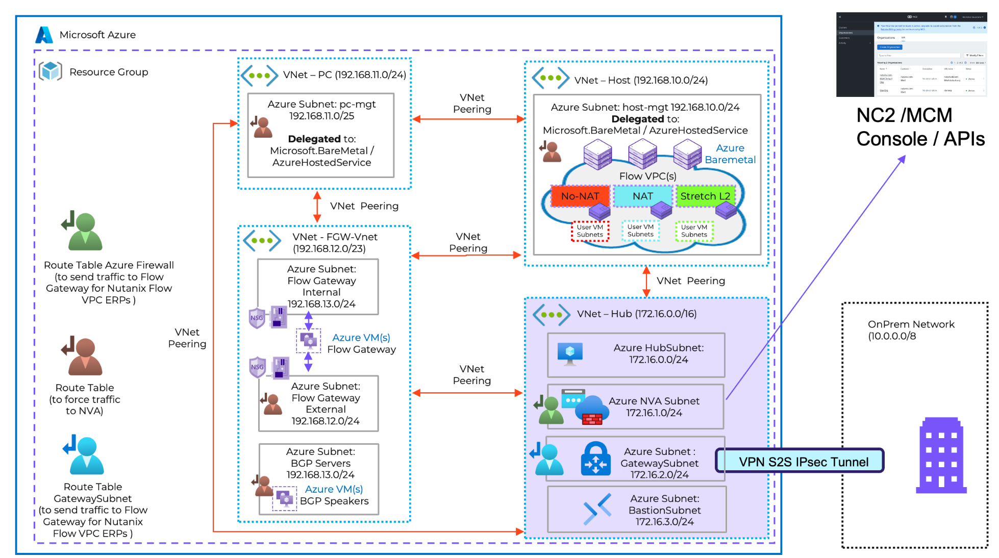 


- Do not forget opening Protocols & Port for Inbound connection on the Azure Network Security Group applied to External Azure NIC of Nutanix Flow Gateway 

Find the Security Group in the Azure resource group where the cluster has been deployed. Name should be something like FGW_XXXXXXXX_EXTERNAL_SUBNET_SG

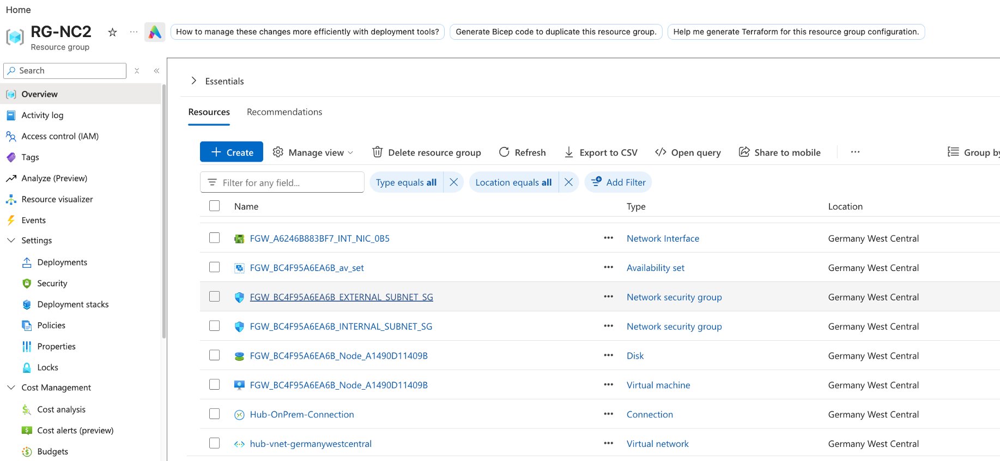 

Default NSG rules for inbound traffic are like that :

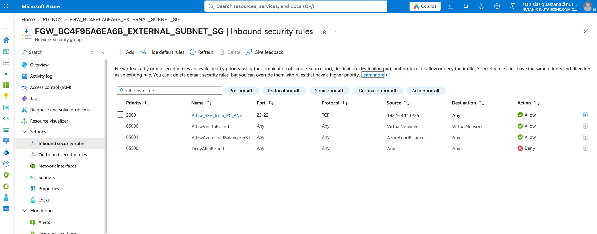 

Add additional rules to match which incoming  trafic to allow. Here I opened everything (for demo purpose and probably lazyness). Open what you need only !

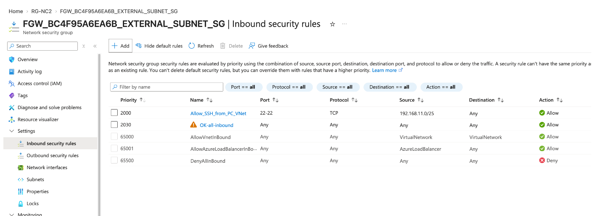 

Create an outbound rule to allow outbound trafic to DC CIDR range

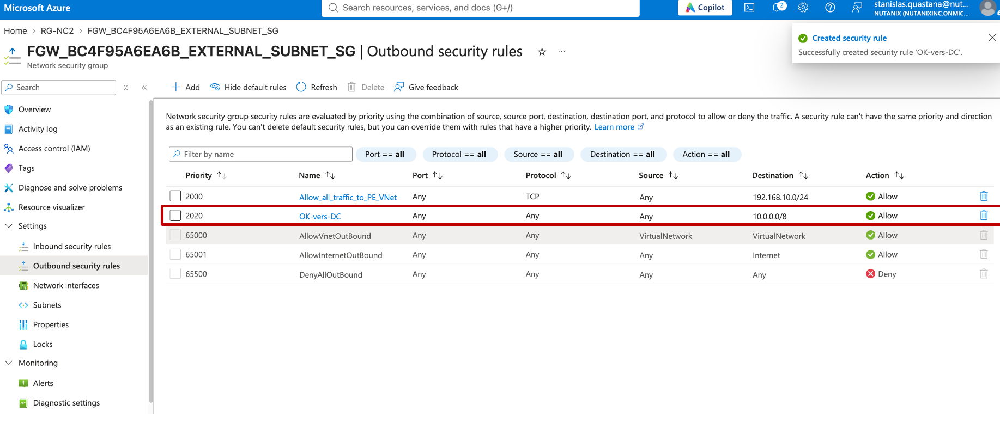 


### Deployment of Nutanix VM and network connectivity tests

8. Deploy a Nutanix VMs connected to Flow VPC user-vpc-2-subnet-1 (NoNAT path) 

9. Test connectivity 1 : between Nutanix VM connected to Flow user-vpc-2 and a workstation on-premises

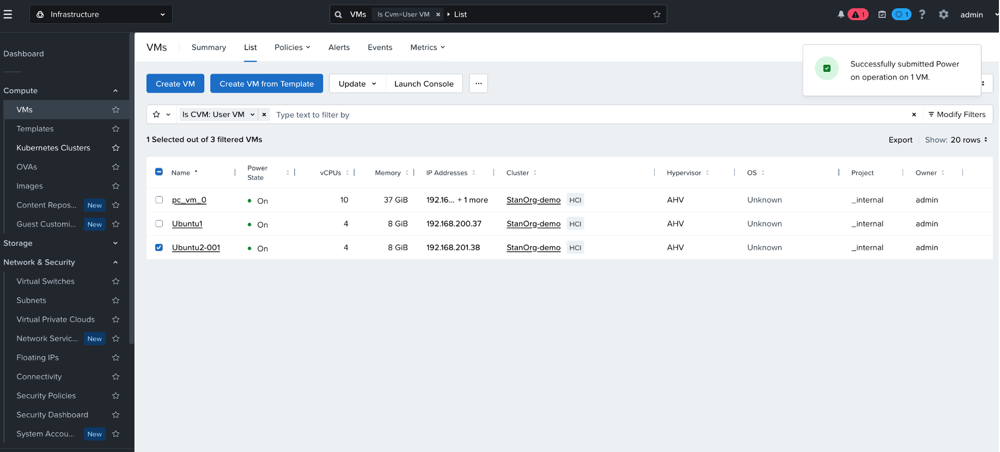 

Ubuntu2-001 is connected to user-vpc-2-subnet-1 and has the IP address 192.168.201.38 

Let's connect this VM from a system running on-premises (here my Macbook Pro)

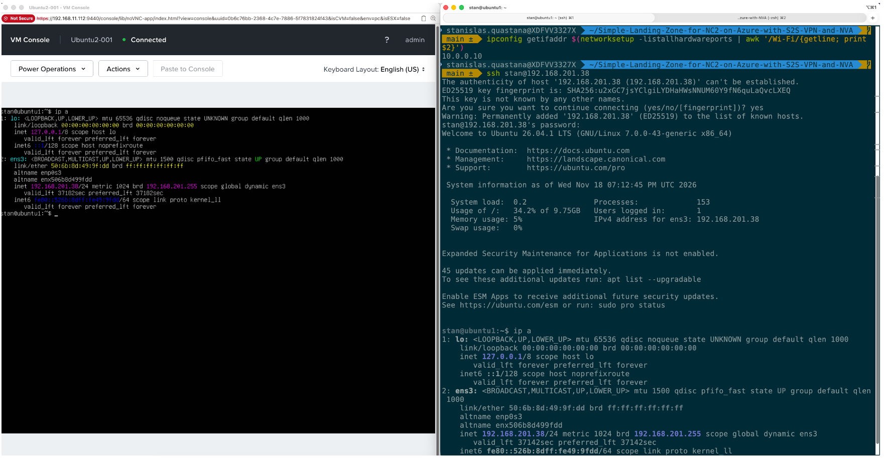 

We are good ! :)


10. Test connectivity 1 : between Nutanix VM connected to Flow user-vpc-2 and Internet

By default Nutanix VM doesn't have an Internet access :

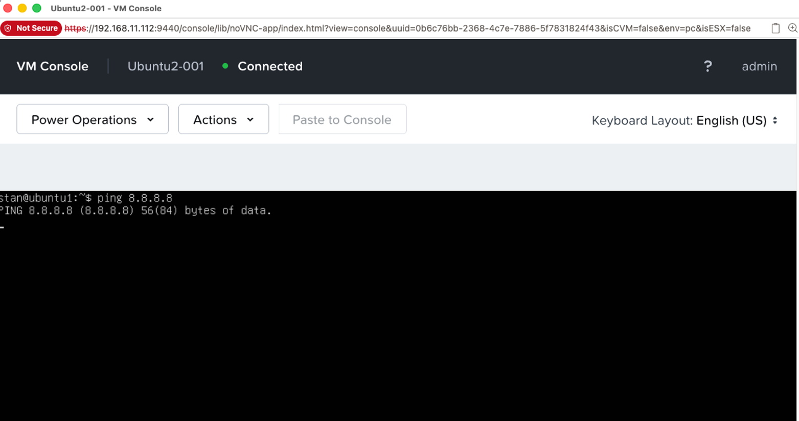 

This is normal : the current configuration of Azure Firewall allows all outbound trafic for the following Azure Subnets CIDRs : PC subnet, Flow External Subnet, ClusterMngt Subnet and BGP Subnet.

We need to allow access for Flow VPC user-vpc-2 CIDR.

There is 2 ways to do that :
- update the [Azure IP Group](https://learn.microsoft.com/en-us/azure/firewall/ip-groups) named nc2-ip-group by adding Flow VPC CIDR
- create a dedicated Azure Firewall rule

Let's do the second way


10. When you want to destroy the Nutanix Cluster, use the NC2 Portal (https://cloud.nutanix.com) to terminate it.

11. After cluster terminaison, you can destroy the landing zone using the following command : 

```bash
terraform destroy --var-file=configuration.tfvars
```


## How much does it cost to test this landing zone ?

You can use **infracost** (available on https://www.infracost.io/) to check the estimate price for 1 month. Here is an exemple for Azure Germany West Central region

 Don't be afraid of the cost of Azure Firewall : here I was using a Standard edition :) you can change its SKU if needed

 

  :exclamation: Important : this landing zone cost estimation does not include the cost of Azure Baremetal instance(s) used as node(s) in the Nutanix Cluster. 
 
 Please have a look of metal instances prices here : https://azure.microsoft.com/en-us/pricing/details/nutanix-on-azure/ 
 
 Pricing is per instance-hour consumed for each instance, from the time an instance is launched until it is terminated or stopped. 

 Note : you don't need Azure Bastion or Jumbox 24/7. You can simply enable or disable these resources in configuration.tfvars file (0= disabled , 1=enabled) 