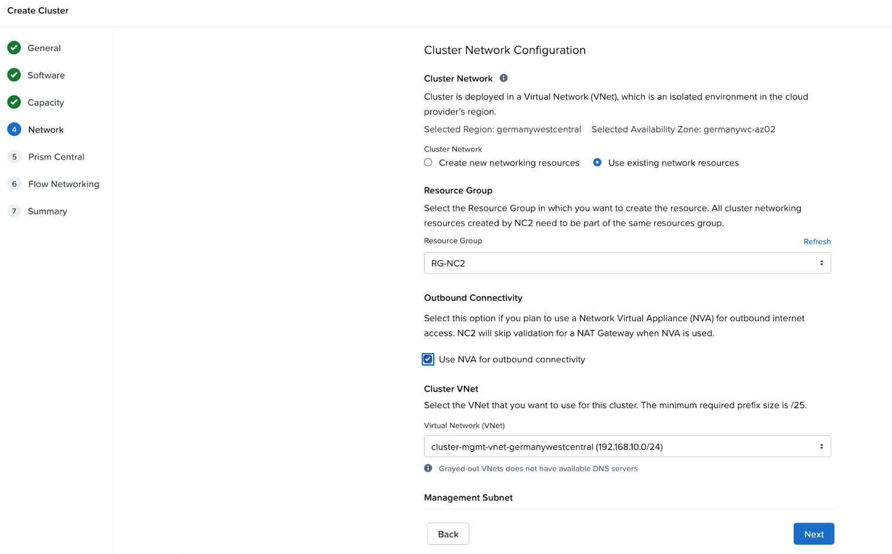
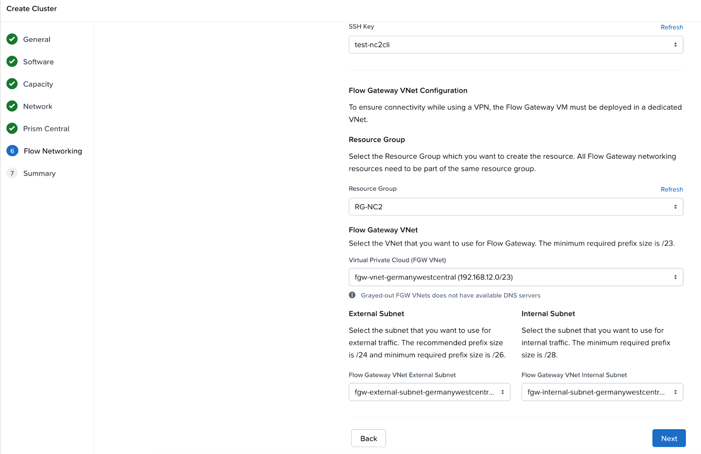
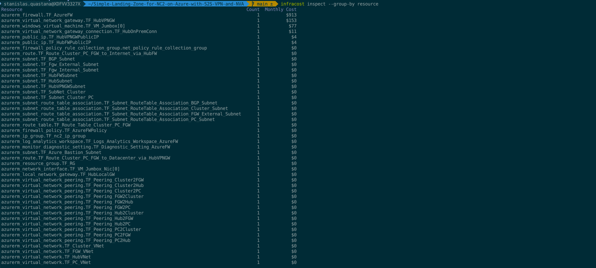

# Simple-Landing-Zone-for-NC2-on-Azure-with-S2S-VPN-and-NVA
A sample of Azure landing zone for Nutanix Cloud Cluster with an Hub VNet, Site to Site VPN and NVA

 

## Scenario interconnection with an Azure VPN Gateway on a Hub and Spoke topology with a Network Virtual Appliance (Here Azure Firewall) that control outbound traffic to Internet.

This repo contains Terraform files to deploy all Azure network components needed to deploy Nutanix Cloud Cluster(NC2) on Azure Baremetal.

 

:warning: This code applies for the following scenarios :
- You access this cluster from On-premises through a Site to Site VPN IPsec tunnel (between an Azure VPN Gateway and your IPsec VPN Gateway)) and the [Hub and Spoke Topology](https://learn.microsoft.com/en-us/azure/architecture/networking/architecture/hub-spoke?tabs=cli)

Network schema of this Landing Zone is available below.

Notes: On Azure Firewall I simply create an allow outbound trafic network rule. You should restrict communications according to best practices and prerequisite here : https://portal.nutanix.com/page/documents/solutions/details?targetId=TN-2156-NC2-on-Azure:tn-outbound-communication.html

## Prerequisites

- All prerequisites for NC2 : https://portal.nutanix.com/page/documents/details?targetId=Nutanix-Cloud-Clusters-Azure:nc2-clusters-azure-getting-ready-for-deployment-c.html

- An Azure Subscription with enough privileges (create RG, Virtual Machine ...)
- Azure CLI 2.9 or >: <https://docs.microsoft.com/en-us/cli/azure/install-azure-cli?view=azure-cli-latest>
- Terraform CLI 1.17.2 or > : <https://www.terraform.io/downloads.html>

You can also clone this repo in your [Azure Cloud Shell](https://shell.azure.com) (that has all tools installed)

## Step by step operations

__Read the code and comments to understand what Azure resources will be created.__

Duplicate [example-configuration.tfvars](example-configuration.tfvars) to configuration.tfvars to define your Azure resources names.
 

1. Terraform Init phase  

```bash
terraform init
```

2. Terraform Plan phase

```bash
terraform plan --var-file=configuration.tfvars
```

3. Terraform deployment phase (add TF_LOG=info at the beginning of the following command line if you want to see what's happen during deployment)

```bash
terraform apply --var-file=configuration.tfvars
```

4. Wait until the end of deployment (It should take less than 45 minute, Azure VPN Gateway is the longuest resource to deploy)

 

If you want to connect to Prism Element or Prism Central through Internet, there is an option to enable an Azure Bastion instance and a Windows Server 2025 Virtual Machine Jumbox.

5. Go to Nutanix [NC2 Portal](https://cloud.nutanix.com) https://cloud.nutanix.com and start your Nutanix Cluster deployment wizard. In steps 4 (Network), 5 (Prism Central) and 6 (Flow Networking) select the Virtuals Networks and Subnets created in step 3 using terraform. Do forget to check "Use NVA for outbound connectivity"

 


 


 


 


6. After the deployment is successfull, __you have additional steps to perform for routing (and optionnaly firewalling) to and from on-premises network__ :

- Option 1 - Every traffic should pass through the NVA (here Azure Firewall) --> change the routing table assigned to Hub Subnets (especially GatewaySubnet) to avoid assymetric routing (network request from NC2 cluster going through NVA and network answer not going through NVA)

- Option 2 - Communication between NC2 cluster (and its workloads) and on-premises Datacenter do no go through NVA. Only network traffic from NC2 cluster (and it workloads) to Internet goes through the NVA.

__IMPORTANT : Next steps documented are for Option 2__


    - Create and configure Nutanix Flow VPC in Prism Central

    
    
     If you enabled AzureBastion and Jumpbox VM, you can login to the Jumbox VM and connect Prism Element or Prism Central through a web browser.

    - Create and configure Nutanix Flow VPC in Prism Central


7. Use the solution and configure Nutanix features like [Flow VPC](https://squasta.github.io/configurationvpcazure.html), categories...

9. When you want to destroy the Nutanix Cluster, use the NC2 Portal (https://cloud.nutanix.com) to terminate it.

10. After cluster terminaison, you can destroy the landing zone using the following command : 
```bash
terraform


## How much does it cost to test this landing zone ?

You can use **infracost** (available on https://www.infracost.io/) to check the estimate price for 1 month. Here is an exemple for Azure Germany West Central region

 Don't be afraid of the cost of Azure Firewall : here I was using a Standard edition :) you can change its SKU if needed

 

  :exclamation: Important : this landing zone cost estimation does not include the cost of Azure Baremetal instance(s) used as node(s) in the Nutanix Cluster. 
 
 Please have a look of metal instances prices here : https://azure.microsoft.com/en-us/pricing/details/nutanix-on-azure/ 
 
 Pricing is per instance-hour consumed for each instance, from the time an instance is launched until it is terminated or stopped. 

 Note : you don't need Azure Bastion or Jumbox 24/7. You can simply enable or disable these resources in configuration.tfvars file (0= disabled , 1=enabled) 